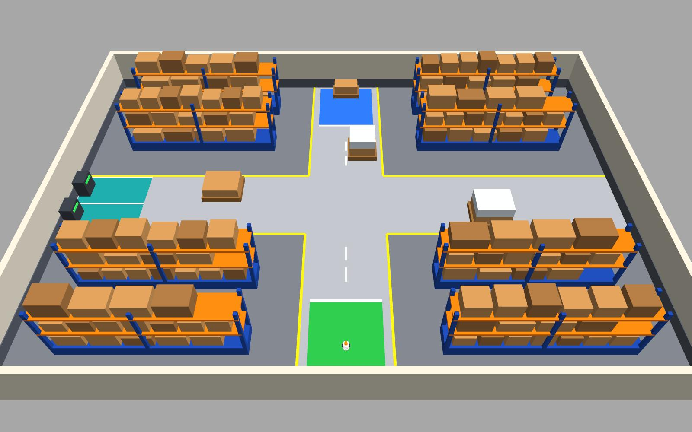
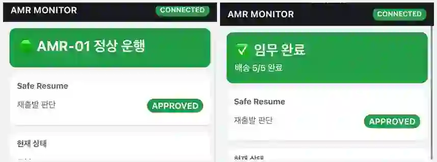
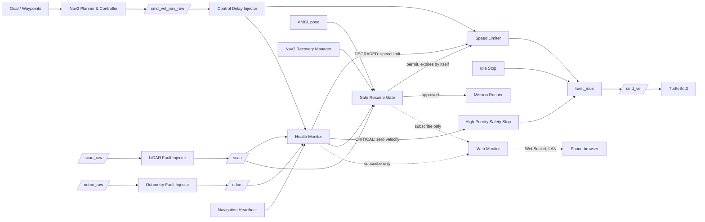

# ROS2 Fault-Tolerant Autonomous Mobile Robot

**Fault diagnosis, degraded control, safe stop, and recovery during Nav2 warehouse missions.**

> **한 줄 요약:** Nav2로 창고 waypoint 임무를 수행하는 TurtleBot3에서 LiDAR·Odometry·제어 지연·Navigation 프로세스 이상을 실제로 주입하고, 고장 수준에 따라 **감속 → Safe Stop → 복구 → 임무 재개**를 수행하는 ROS2 기반 fault-tolerant AMR 시스템입니다.



<!-- SAFE-RESUME-MOBILE-2026-11 -->
## Safe Resume Gate & QR mobile monitoring (Nov 2026)

**Fault response continues beyond the emergency stop:** a robot may resume its warehouse delivery only after its safety checks pass. A **read-only mobile monitor** makes the current status, fault cause, recovery stage and mission progress visible to an operator on a phone, with no separate app or account.



*Actual mobile monitoring views from the home-network demonstration — normal operation (left) and 5/5 delivery mission completed (right). The QR link is generated dynamically for the current local network.*

| Feature | Implementation / verification |
|---|---|
| **Safe Resume Gate** | LiDAR, validated odometry, Nav2 lifecycle, AMCL localization, forward obstacle clearance, control latency, and overall monitor health; approval after 3 s of stable valid conditions. |
| **Fail-closed motion gating** | Missing, stale, or unhealthy inputs block restart. Nav2 velocity is held at zero if permission is missing/expired. |
| **Recovery and mission continuity** | Existing Nav2 recovery and waypoint runner resume the interrupted delivery when authorized. |
| **Operator monitoring** | LAN QR code → responsive mobile dashboard, live WebSocket updates, diagnosed fault status, location, recovery progress, alert history, and Safe Resume reason. |
| **Read-only safety separation** | The web service does not publish robot motion commands or invoke recovery services. |
| **Observed tests** | Safe Resume integration 176/176 and web monitor 75/75 in the latest runs; a real phone over home Wi-Fi displayed the normal state and mission completion. Details and intermittent results: [Automated verification](#automated-verification). |

**Demo:** `./setup_web_monitor.sh` once, then `./run_web_demo.sh` (see [Run the project](#run-the-project)). The phone must reach the laptop on the same LAN. Some campus Wi-Fi networks isolate clients; use a permitted hotspot or router in that case. QR codes contain a network-local address, not a globally accessible service.

A successful unit or integration test is **not** a functional-safety certification. Open issues are listed under [Known limitations](#known-limitations).

---

## Why this project?

Autonomous mobile robots usually operate under the assumption that sensors, control messages, and navigation processes remain healthy.

This project focuses on the opposite case:

> **What should the robot do when a sensor becomes unavailable, odometry becomes implausible, control commands are delayed, or a navigation process fails?**

Instead of only detecting an error, the system evaluates fault severity and changes robot behavior in stages:

**NORMAL → WARNING → DEGRADED → CRITICAL**

- **WARNING** — detect and monitor abnormal behavior
- **DEGRADED** — continue operation with reduced performance
- **CRITICAL** — override normal commands and force a safe stop
- **RECOVERY** — return to normal operation only after a healthy hold period

The current system runs a real Nav2 waypoint mission in a warehouse simulation while the fault-tolerant layer supervises and overrides the navigation output when required.

---

## At a glance

| Item | Current implementation |
|---|---|
| Robot | TurtleBot3 Burger |
| Middleware | ROS2 Humble |
| Navigation | Nav2 + AMCL + DWB |
| Simulation | Gazebo Classic 11 |
| Environment | Reproducible warehouse / AMR world |
| Faults | LiDAR dropout, odometry anomaly, control latency, navigation-process failure |
| Response | Warning, sample rejection, speed degradation, independent safe stop, recovery |
| Safety arbitration | `twist_mux` with independent high-priority safety command |
| Restart safety | Safe Resume Gate: fail-closed permit in the Nav2 command path |
| Monitoring | tkinter dashboard, read-only QR mobile web monitor (FastAPI + WebSocket), CSV / JSON result logging |
| Verification | Automated fault, regression, integrated-demo, and Nav2 mission tests |

---

## System architecture



A key design rule is that **normal navigation never owns the final robot command directly**.  
Nav2 output passes through the fault-tolerant control layer before reaching `/cmd_vel`.

---

## Fault scenarios

| Fault | How it is injected | Detection | Response |
|---|---|---|---|
| **LiDAR dropout** | Stop forwarding real `/scan` messages | Scan message age | WARNING → DEGRADED → CRITICAL → Safe Stop |
| **Odometry anomaly** | Change `twist.linear.x` to an implausible value (e.g. 2.5 m/s) | Speed bound, acceleration bound, command consistency | Reject bad sample; persistent fault → DEGRADED speed |
| **Control latency** | Actually hold navigation commands for 300 / 700 ms | Measured receive-to-publish latency | 300 ms → DEGRADED, 700 ms → CRITICAL Safe Stop |
| **Navigation process failure** | Terminate the navigation command-source process | Heartbeat age + PID change | Idle stop / Safe Stop → process respawn → healthy hold → resume |

These are **real data-flow or process faults**, not only Boolean fault flags.

---

## Fault-response policy

| System state | Robot behavior |
|---|---|
| **NORMAL** | Normal Nav2 command, up to 0.20 m/s |
| **WARNING** | Continue operation while monitoring |
| **DEGRADED** | Limit final velocity to approximately 0.10 m/s |
| **CRITICAL** | High-priority zero command overrides navigation |
| **RECOVERY** | Keep degraded/stopped state until healthy data is stable for ~2 s |

Hysteresis and consecutive-sample conditions are used to avoid state chattering.

---

## Autonomous warehouse mission

The final simulation environment is a **14 m × 10 m indoor warehouse** with shelves, narrow aisles, intersections, pallets, a start zone, charging area, and delivery zone.

The world and occupancy map are generated from the same geometry definition so they remain reproducible and aligned.

Current mission:

```text
Start
  ↓
Central Intersection
  ↓
East Cross Aisle
  ↓
North-East Narrow Aisle
  ↓
Delivery Zone
```

### Representative Nav2 result

| Metric | Result |
|---|---:|
| Waypoints reached | **4 / 4** |
| Mission success | **True** |
| Mission time | **122.9 s** |
| Distance travelled | **19.0 m** |
| Collision count | **0** |
| Minimum map clearance | **0.398 m** |
| Final goal-position error | **0.132 m** |
| Mission retries | **0** |

During this mission, LiDAR, odometry, and control-latency faults are injected while Nav2 is actively navigating. After the fault response and recovery hold, the mission continues to the final Delivery goal.

---

## Representative fault results

| Scenario | Measured behavior |
|---|---|
| **LiDAR dropout** | CRITICAL in ~**0.95 s**, final command **0.00 m/s**, stopped-window movement **0.0 mm**, recovery to NORMAL ~**2.14 s** |
| **Odometry anomaly** | Injected **2.5 m/s** value rejected; persistent anomaly → DEGRADED in ~**0.15 s**; final velocity limited to **0.10 m/s** |
| **300 ms control delay** | Measured latency ~**0.303 s**, system enters DEGRADED |
| **700 ms control delay** | Measured latency ~**0.703 s**, CRITICAL in ~**0.46 s**, final command **0.00 m/s**, stopped-window movement **0.0 mm** |
| **Navigation process crash** | Old PID disappears, a new process is respawned, robot remains stopped until the healthy hold completes, then motion resumes |

Selected machine-readable results are committed under:

- `results/final_summary.csv`
- `results/final_summary.json`
- `results/nav2_summary.csv`
- `results/nav2_summary.json`

Raw runtime logs are intentionally excluded from Git.

---


## Nav2 Lifecycle Recovery

The Nav2 stack is now supervised at runtime and can recover from lifecycle faults and an actual controller process crash while the warehouse mission is active.

Monitored lifecycle nodes:

- `controller_server`
- `planner_server`
- `bt_navigator`
- `behavior_server`

The recovery manager checks lifecycle state at runtime and treats inactive, missing, or unresponsive nodes as a navigation-stack fault. The Nav2 stack state is integrated into the same system severity model used by the sensor and control faults.

Representative behavior:

- controller or planner deactivation is detected and escalates to CRITICAL
- the high-priority safety path forces the robot to stop
- the lifecycle manager is used to restore the navigation stack
- after a healthy hold, the active waypoint mission resumes
- an actual `controller_server` process crash is detected, respawned with a new PID, restored to ACTIVE, and the mission continues
- a recovery-block mode verifies that failed recovery keeps the robot in CRITICAL with zero movement

Validated odometry is also connected to the relevant Nav2 velocity-feedback path:

```text
Gazebo /odom_raw
      |
      v
odom_fault_injector
      |
      v
     /odom
      |
      v
health_monitor plausibility check
      |
      v
/odom_validated
      |
      +--> controller_server
      +--> bt_navigator
```

Implausible odometry samples are therefore rejected before they are used as Nav2 velocity feedback, while the odom-to-base TF and AMCL localization path remain unchanged.

### Recovery verification

Before the Safe Resume Gate was added, the automated Nav2 recovery test passed **42/42 checks in three consecutive runs**. Current results are under [Automated verification](#automated-verification).

Representative results:

| Scenario | Result |
|---|---|
| Controller deactivate | CRITICAL stop → lifecycle recovery → mission resume |
| Planner deactivate | CRITICAL stop → lifecycle recovery → mission resume |
| Controller process crash | Old PID disappears → new PID respawned → stack ACTIVE → mission resume |
| Recovery blocked | Max attempts reached → CRITICAL maintained → 0.0 mm movement |
| Recovery unblocked | Stack recovers → NORMAL → mission resumes |
| Odometry corruption | 2.5 m/s corrupted sample rejected from `/odom_validated` |

The extended recovery mission reached **5/5 waypoints** and completed the Delivery mission with **0 collisions**.

Selected results:

- `results/nav2_recovery_summary.csv`
- `results/nav2_recovery_summary.json`

## Safe Resume Gate

`/health/state` returning to NORMAL is not enough to move again. `fault_monitor/safe_resume_gate.py` re-checks every condition and grants a permit only after all of them have held for **3 s**.

| Condition | Required for approval |
|---|---|
| LiDAR | Fresh scan, rate, usable rays, health NORMAL |
| Odometry | Health NORMAL, fresh validated odometry, no recent rejected sample |
| Nav2 | All monitored servers ACTIVE, recovery manager IDLE |
| Localization | Fresh `/amcl_pose`, `map` frame, covariance within limits |
| Forward clearance | Free distance >= speed x (reaction + latency) + braking + margin + robot radius |
| Control | Fresh latency sample, <= 100 ms |
| System | `health_monitor` alive, state NORMAL |

States: `WAITING`, `VERIFYING`, `APPROVED`, `BLOCKED`. Thresholds are in `src/fault_bringup/config/safe_resume.yaml`.

- **Fail-closed:** `speed_limiter` forwards Nav2 commands only while a true permit is fresher than 0.5 s. If the gate is missing, crashed or hung, the Nav2 channel closes by itself.
- **Single stop path:** `/cmd_vel_safety` remains published only by `health_monitor`; the gate never publishes velocity.
- **Mission:** the waypoint runner stays PAUSED while denied and resumes the same waypoint when approved.
- **After approval:** CRITICAL, stale or invalid data, or insufficient clearance revoke the permit at once. WARNING and DEGRADED stay with the existing speed limit and do not revoke it.

---

## QR mobile monitoring

`src/fault_web` is a separate, read-only process: it publishes nothing to the robot and calls no robot service, so stopping it does not affect fault handling.

- **Alerts:** one alert per fault episode, immediately on CRITICAL, with robot ID, time, cause, state, location, stop status, recovery stage, Safe Resume status and whether an operator is needed.
- **Causes:** only what diagnostics show, for example "LiDAR data reception stopped", never an unproven hardware claim.
- **Old data is never shown as current:** no diagnostic data gives UNKNOWN, an invalid pose is shown as the last confirmed position with its time, and a lost connection is marked on the page while it reconnects.
- **QR page:** shows the detected LAN address, updates when the network changes, and reports how far each phone got (page request, JavaScript, WebSocket) to separate network problems from browser problems.

---

## Dashboard

The monitoring dashboard shows the system state in real time:

- overall **NORMAL / WARNING / DEGRADED / CRITICAL** state
- individual LiDAR, odometry, control-latency, and navigation health
- scan age, odometry validity, measured control latency, navigation heartbeat / PID
- target velocity, final command, measured odometry velocity
- degraded speed limit and safety-stop state
- waypoint mission progress
- recent fault and state-transition events
- buttons for manual fault injection

The same services used by the automated tests are used by the dashboard, so the UI does not contain separate fault logic.

---

## Engineering decisions

### 1. Independent safety command path

The safety command does not compete with Nav2 at the same priority.

```text
/cmd_vel_safety      priority 255
/cmd_vel_nav_limited priority 10
/cmd_vel_idle_stop   priority 1
```

This allows a CRITICAL state to override a continuing non-zero Nav2 command.

### 2. Fail-safe behavior when navigation commands disappear

A low-priority zero-velocity source remains active.  
If the normal navigation publisher disappears, `twist_mux` falls back to the idle-stop command instead of leaving the robot on a stale velocity command.

### 3. Fault injection changes the real signal path

Examples:

- LiDAR: `/scan_raw → injector → /scan`
- Odometry: `/odom_raw → injector → /odom`
- Control latency: navigation commands are actually queued and delayed
- Navigation failure: the process is actually terminated and respawned

### 4. Reproducible simulation environment

The warehouse world and 2D occupancy map are generated from the same obstacle geometry rather than maintained independently.

---

## Automated verification

| Test suite | Result |
|---|---:|
| Fault 1 — LiDAR | **23 / 23 PASS** |
| Fault 2 — Odometry | **21 / 21 PASS** |
| Fault 3 — Control latency | **36 / 36 PASS** |
| Fault 4 — Navigation process | **36 / 36 PASS** |
| Integrated fault demo | **25 / 25 PASS** |
| Nav2 warehouse fault demo | **25 / 25 PASS** |
| Nav2 lifecycle recovery | **42 / 42 PASS** in the latest run, intermittent (below) |
| Safe Resume Gate (T0-T8) | **176 / 176 PASS** in the latest run, intermittent (below) |
| Web monitor with Gazebo faults and real browsers | **75 / 75 PASS** |
| Unit tests (`fault_monitor`, `fault_web`) | **27 / 27 PASS** |

The first six suites were run once on the Safe Resume code. While a request is denied, the Safe Resume test also publishes 0.2 m/s on Nav2's output topic and requires final `/cmd_vel` = 0 and no ground-truth motion (at most 0.1 mm measured).

**Intermittent:** the check "goal position error < 0.25 m" does not pass in every run, and when it fails that suite fails.

| Code / test | Measured error | Runs failing the check |
|---|---|---:|
| Before Safe Resume, recovery test | 0.119 - 0.256 m | 1 of 6 |
| Current, recovery test | 0.216 - 0.284 m | 2 of 4 |
| Current, Safe Resume test | 0.136 - 0.334 m | 1 of 3 |

The cause is not confirmed, and the samples are too few to rule out an effect of the gate. The threshold was not relaxed.

The web monitor suite was last run before the later mobile-page changes (device diagnostics, connection-error messages); those changes were checked only with the unit tests and the emulated mobile browser check below.

**Checked by hand, no automated suite in this repository:** a real phone on home Wi-Fi (normal state and mission completion), mobile page behaviour in emulated mobile Chromium, and shutdown with one Ctrl+C.

**Not verified:** Safari / iOS, phone access during fault scenarios (faults were verified in desktop headless browsers), and phone access on campus Wi-Fi.

---

## Run the project

### Environment

- Ubuntu 22.04
- ROS2 Humble
- Gazebo Classic 11
- TurtleBot3 Burger
- Nav2
- `twist_mux`
- Python 3 / rclpy

> Current helper scripts assume the workspace path is `~/capstone_fault_ws`.

Build:

```bash
cd ~/capstone_fault_ws
colcon build --symlink-install
source env.sh
```

### Mobile monitoring demo

```bash
./setup_web_monitor.sh    # once: creates .venv_web, system Python is not changed
./run_web_demo.sh         # Gazebo + Nav2 + dashboard + mission + web monitor + QR page; Ctrl+C stops everything
./run_web_monitor.sh      # or attach only the monitor to a running system
```

Scan the QR code shown on the PC with a phone on the same network. Faults are injected with the dashboard buttons. Hotspot and troubleshooting notes: `src/fault_web/README.md`.

### Warehouse + Nav2 + dashboard

```bash
./run_nav2.sh dashboard:=true autostart_mission:=true
```

### Automated Nav2 + fault demo

```bash
./run_nav2_demo.sh
```

This runs the warehouse waypoint mission while automatically injecting Fault 1 / 2 / 3 and writes `results/nav2_summary.*`.

### Warehouse integrated fault demo

```bash
./run_warehouse_demo.sh
```

### Individual regression tests

```bash
./run_fault1_test.sh
./run_fault2_test.sh
./run_fault3_test.sh
./run_fault4_test.sh
./run_nav2_recovery_test.sh
./run_safe_resume_test.sh
./run_web_monitor_test.sh    # first: ./setup_web_monitor.sh --test
```

---

## Repository structure

```text
.
├── src/
│   ├── fault_injector/      # LiDAR, odometry, control-delay, navigation fault injection
│   ├── fault_monitor/       # health monitoring, speed limiting, idle stop, Nav2 recovery, Safe Resume Gate
│   ├── fault_bringup/       # launch, dashboard, Nav2 mission, maps, worlds, configs
│   └── fault_web/           # read-only alerts, FastAPI + WebSocket server, mobile page, QR code
├── docs/images/             # presentation / portfolio images
├── results/                 # selected quantitative summaries
├── run_nav2.sh
├── run_nav2_demo.sh
├── run_web_demo.sh
├── run_web_monitor.sh
├── run_warehouse_demo.sh
├── run_integrated_demo.sh
└── run_fault*_test.sh
```

---

## Current status

### Completed

- [x] TurtleBot3 + Gazebo simulation baseline
- [x] LiDAR dropout detection and Safe Stop
- [x] Odometry plausibility monitoring and degraded control
- [x] Real control-latency injection and response
- [x] Navigation process failure / respawn test
- [x] Independent safety arbitration with `twist_mux`
- [x] Monitoring dashboard
- [x] Reproducible warehouse AMR environment
- [x] Nav2 4-waypoint autonomous mission
- [x] Fault 1 / 2 / 3 response during active Nav2 navigation
- [x] Automated regression and quantitative summaries
- [x] Nav2 lifecycle-node failure detection and automatic recovery
- [x] Validated odometry in the Nav2 velocity-feedback path
- [x] Safe Resume Gate with fail-closed motion permit
- [x] Administrator alerts and read-only QR mobile monitor

### Planned

- [ ] Scenario manager for reproducible multi-fault experiments
- [ ] Expanded quantitative evaluation
- [ ] Optional real-robot deployment

---

## Known limitations

- **Goal-position error:** intermittently above 0.25 m, cause not confirmed (see [Automated verification](#automated-verification)).
- **AMCL covariance limits:** approval 0.25 m², stay-approved 1.0 m². The first limit of 0.10 m² stopped a fault-free mission 21 times, so the limits were set from measured fault-free runs (maximum about 0.73 m²). One run still exceeded 1.0 m² and paused for about 20 s before resuming by itself.
- **Forward-only clearance:** reverse motion and in-place rotation are not checked.
- **After approval:** implausible odometry and 100-500 ms control latency keep the permit and use the existing 0.10 m/s limit.
- **No-motion AMCL updates:** requested every 2 s at rest because AMCL does not publish otherwise. Long stops were not evaluated separately.
- **Web monitor access:** no password; anyone on the same network can view it, but nothing can be controlled. Browser-closed push notifications and remote recovery commands are not implemented.
- **Unexplained once:** an orphaned `gzserver` was found once during shutdown testing and did not reproduce in later runs. If it appears, the start script refuses to run and reports it instead of killing it.

---

## Scope

This is an implementation-focused university capstone project for studying runtime fault handling in autonomous mobile robots.

The design uses concepts such as fault detection, degraded operation, safe stop, and recovery, but it **does not claim ISO 26262, SOTIF, or other functional-safety certification compliance**.
